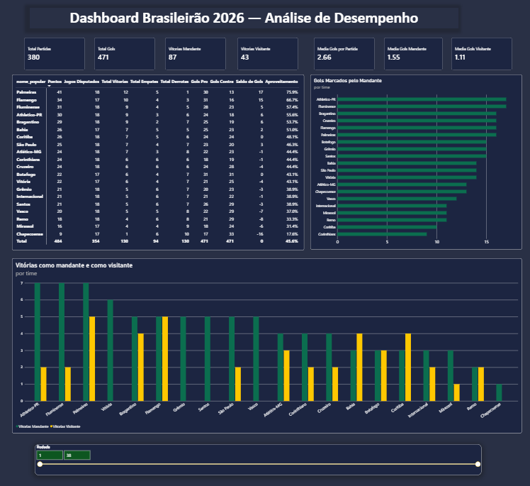
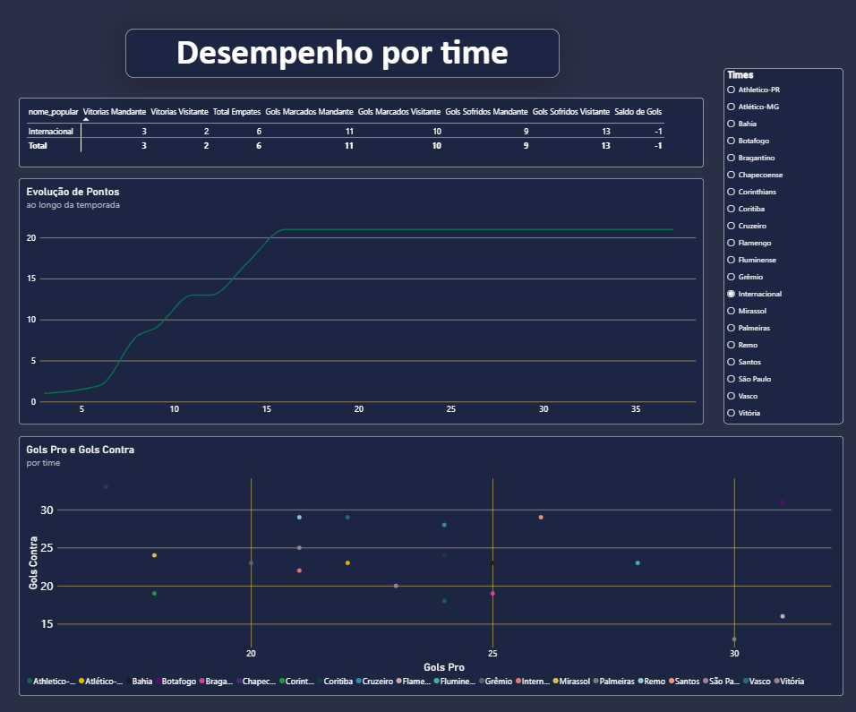
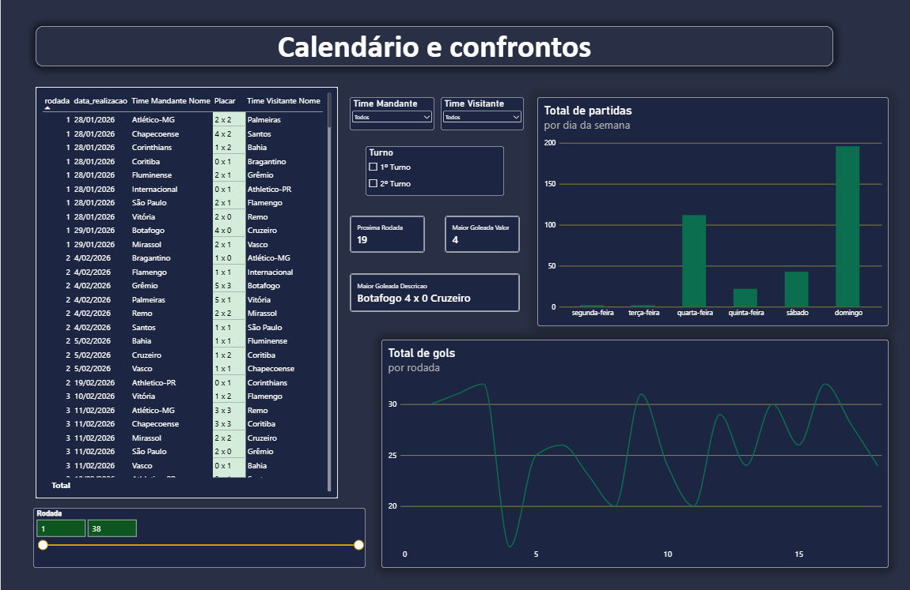

# ⚽ Análise e Previsão de Resultados — Brasileirão 2026

Pipeline completo de dados esportivos: da extração via API até um dashboard interativo e um modelo de Machine Learning servido por uma API própria.

Projeto desenvolvido como parte da formação em Ciência de Dados e Machine Learning (UniCEUB), com foco em aplicar, na prática, um fluxo de dados de ponta a ponta — não apenas uma análise isolada.

---

## 🎯 Visão geral

```
API pública (api-futebol.com.br)      Histórico 2003–2024 (dataset público)
   temporada 2026                                  │
        │                                          │
        ▼                                          ▼
  extract.py / load_db.py             extract_historico.py / load_historico.py
        │                                          │
        └──────────────► MySQL ◄───────────────────┘
                (partidas, times, partidas_historico)
                           │
                           ▼
          src/features.py — rating Elo + forma recente
          (mesmo código no treino e na API)
                           │
          ┌────────────────┼─────────────────┐
          ▼                ▼                 ▼
   Modelo de ML      API própria       Dashboard (Power BI)
   (notebook v2)     (FastAPI)         - Visão Geral
                           │           - Desempenho por Time
                           ▼           - Calendário e Confrontos
          Automação (Make) — dispara a atualização dos dados
```

---

## 📊 O problema

O objetivo do projeto foi construir uma solução que:

1. Coletasse dados reais de partidas, times e resultados de forma automatizada
2. Armazenasse esses dados de forma estruturada e consultável
3. Analisasse padrões de desempenho (aproveitamento, saldo de gols, fator casa)
4. Estimasse a probabilidade de resultado de uma partida (vitória do mandante, empate ou vitória do visitante)
5. Apresentasse tudo isso de forma visual e interativa

---

## 🗂️ Estrutura do repositório

```
futebol-analytics/
├── data/
│   ├── raw/                     # JSON da API e CSV do histórico (não versionados)
│   └── processed/
│       ├── partidas.csv         # todas as partidas (histórico + 2026), formato único
│       └── dataset_modelo.csv   # dataset da v1 (mantido para comparação)
├── src/
│   ├── extract.py               # extração da temporada 2026 via API
│   ├── load_db.py               # carga da temporada 2026 no MySQL
│   ├── extract_historico.py     # download do histórico 2003–2024
│   ├── load_historico.py        # carga do histórico no MySQL
│   └── features.py              # rating Elo + forma recente (usado no notebook e na API)
├── notebooks/
│   ├── analise_exploratoria.ipynb   # EDA da temporada 2026 e modelo v1
│   └── modelagem_v2.ipynb           # validação temporal, baselines e modelo final
├── api/
│   ├── main.py                  # API FastAPI (previsão, times, atualização)
│   └── modelo_resultado.pkl     # modelo treinado + lista de features + parâmetros do Elo
├── dashboard/
│   └── dashboard_futebol.pbix   # dashboard Power BI (3 páginas)
├── requirements.txt
└── README.md
```

---

## 🔧 Tecnologias utilizadas

| Categoria          | Ferramentas                                              |
| ------------------ | -------------------------------------------------------- |
| Linguagem          | Python                                                   |
| Extração de dados  | `requests`, API pública (api-futebol.com.br), dataset público no GitHub |
| Banco de dados     | MySQL (MySQL Workbench), `mysql-connector-python`, SQLAlchemy |
| Análise de dados   | Pandas, NumPy, Jupyter Notebook                          |
| Visualização (EDA) | Matplotlib, Seaborn                                      |
| Machine Learning   | scikit-learn (Regressão Logística, Gradient Boosting), rating Elo |
| API                | FastAPI, Uvicorn                                         |
| Dashboard / BI     | Power BI (Power Query, DAX, modelagem em estrela)        |
| Automação          | Make (agendamento + chamada HTTP)                        |
| Versionamento      | Git, GitHub                                              |

---

## 1️⃣ Extração de dados

- **Temporada 2026** — `src/extract.py` percorre as 38 rodadas via API pública, com tratamento de erros e pausa entre requisições. Os dados brutos são salvos em JSON.
- **Histórico 2003–2024** — `src/extract_historico.py` baixa o dataset público [Brasileirao_Dataset](https://github.com/adaoduque/Brasileirao_Dataset) (créditos ao autor, Adão Duque). Ele foi incluído porque a temporada 2026 sozinha tem poucas partidas para treinar um modelo.

## 2️⃣ Banco de dados

Modelagem relacional em MySQL:

- `times` e `partidas` (temporada 2026), com chaves estrangeiras para garantir integridade referencial;
- `partidas_historico` (2003–2024), com índices por temporada e data.

As cargas usam `ON DUPLICATE KEY UPDATE`, permitindo reprocessar os dados sem duplicidade — importante porque placares e datas de jogos adiados mudam ao longo da temporada.

O CSV do histórico não tem coluna de temporada, e usar o ano da data não funciona (a temporada 2020 terminou em fevereiro de 2021). A temporada é derivada da sequência de rodadas.

## 3️⃣ Feature Engineering

Implementado em `src/features.py`, **o mesmo código usado pelo notebook e pela API**, para que as features do treino e da previsão sejam idênticas. As partidas são processadas em **ordem de data**, e cada jogo usa apenas informações de jogos anteriores a ele.

- **Rating Elo**: cada time tem um rating que sobe com vitórias e cai com derrotas — mais quando o resultado é surpreendente ou o placar é largo. Entre temporadas, os ratings voltam 25% em direção à média, e times que aparecem pela primeira vez começam abaixo da média (normalmente são recém-promovidos).
- **Forma recente**: média de pontos e saldo de gols nos últimos 5 jogos da temporada, além da forma do mandante em casa e do visitante fora.

## 4️⃣ Machine Learning

Notebook: `notebooks/modelagem_v2.ipynb`.

**Validação temporal**: treino com 2015–2023, escolha do modelo em 2024 e avaliação final em 2026 (usada uma única vez). A métrica principal é o **log loss**, que avalia as probabilidades previstas — é isso que a API devolve.

Resultado no teste (177 jogos de 2026):

| Modelo                              | Log loss | Acurácia |
| ----------------------------------- | -------- | -------- |
| Baseline: proporções históricas     | 1,045    | 49,2%    |
| Baseline: sempre vitória do mandante | —       | 49,2%    |
| **Regressão Logística (Elo)**       | **1,022** | 48,6%   |

- O modelo com Elo **supera os baselines em log loss** na validação e no teste, com probabilidades razoavelmente calibradas.
- Em **acurácia**, fica empatado com "sempre mandante" (1 jogo de diferença em 177): o ganho está na qualidade das probabilidades, não em acertar mais vezes o resultado mais provável.
- O modelo mais simples venceu: as features de forma recente e o Gradient Boosting não superaram a regressão logística só com o Elo.

> **Sobre a primeira versão:** a v1 reportava 64,7% de acurácia, mas esse número vinha de um único split aleatório com 34 jogos de teste. Repetindo com 30 splits diferentes, o modelo ficou praticamente empatado com o baseline "sempre mandante". A v1 também tinha um vazamento de dados sutil: as médias móveis eram ordenadas por rodada, e jogos adiados levavam resultados futuros para as features. A v2 corrige os dois problemas — a análise completa está no início do notebook.

## 5️⃣ API própria

Construída com FastAPI (`api/main.py`). Na inicialização, a API recalcula o rating Elo e a forma de todos os times com `src/features.py`. Endpoints:

- `GET /` — verificação de status
- `GET /times` — lista os times de 2026 com seus IDs e o rating Elo atual
- `POST /prever` — recebe os IDs do mandante e do visitante e retorna a previsão, as probabilidades de cada resultado e as features usadas
- `POST /atualizar-dados` — roda a extração e a carga da temporada 2026 e recalcula os ratings, pensado para ser acionado pela automação

Exemplo de resposta de `/prever`:

```json
{
  "mandante": "Palmeiras",
  "visitante": "Chapecoense",
  "previsao": "vitoria_mandante",
  "probabilidades": {"empate": 0.135, "vitoria_mandante": 0.815, "vitoria_visitante": 0.049},
  "features": {"elo_diff": 386.991}
}
```

Se o MySQL não estiver disponível, a API e o notebook usam `data/processed/partidas.csv` — assim o projeto roda mesmo sem configurar o banco.

## 6️⃣ Dashboard (Power BI)

Três páginas, com modelagem em **esquema estrela** (tabela-calendário separada, tratamento no Power Query, colunas calculadas em DAX):

**Visão Geral** — tabela de classificação completa (pontos, saldo de gols, aproveitamento), KPIs de gols totais e médias, ranking de ataque, comparação de vitórias mandante vs. visitante.





**Desempenho por Time** — tabela detalhada por time, gráfico de evolução de pontos acumulados ao longo da temporada (filtrável por time), gráfico de dispersão (gols marcados vs. sofridos) para leitura tática do campeonato.

**Calendário e Confrontos** — tabela de todos os confrontos com formatação condicional (jogos finalizados vs. agendados), cartões dinâmicos ("próxima rodada", "maior goleada da temporada"), distribuição de jogos por dia da semana.

> ⚠️ Para abrir o dashboard, é necessário ter o MySQL rodando localmente com os dados carregados (o arquivo `.pbix` não armazena a conexão nem os dados, apenas a estrutura do relatório).

## 7️⃣ Automação (Make)

Cenário configurado no Make com um módulo HTTP (`POST /atualizar-dados`) e agendamento diário, demonstrando como o pipeline de extração e carga poderia ser disparado automaticamente, sem intervenção manual.

**Limitação assumida:** como a API roda localmente (não hospedada na nuvem), essa automação funciona plenamente apenas quando o computador e a API estão ativos no horário agendado. Em uma versão de produção, a API estaria hospedada em um serviço como Render ou Railway.

---

## ⚠️ Limitações conhecidas

- A API de 2026 parou de registrar resultados no fim de maio: os jogos seguintes continuam como "agendado", mesmo com datas que já passaram. Por isso o teste tem 177 partidas.
- O histórico público vai até 2024. Sem 2025, o Elo de 2026 parte dos ratings de 2024 (amenizado pela regressão entre temporadas).
- O modelo não usa escalações, lesões ou dados de mercado, que costumam ser as informações mais fortes nesse problema.

---

## 📈 Principais aprendizados

- **Um número bom pode ser sorte.** Com poucos dados de teste, um único split aleatório não basta: é preciso repetir a avaliação e comparar sempre com um baseline simples.
- **Em séries temporais, a validação tem que respeitar o tempo.** Treinar com jogos de maio e testar com jogos de fevereiro não representa o uso real do modelo.
- **Vazamento de dados é sutil.** O `.shift(1)` protegia a partida atual, mas ordenar por rodada (e não por data) ainda deixava jogos adiados vazarem resultados futuros.
- **Mais dados > modelo mais complexo.** Adicionar o histórico e uma feature bem pensada (Elo) rendeu mais do que trocar de algoritmo; o Gradient Boosting não superou a regressão logística.
- **Treino e previsão devem compartilhar o mesmo código de features**, para evitar que a API calcule algo diferente do que o modelo aprendeu.
- Modelagem correta em Power BI (relações ativas/inativas, `USERELATIONSHIP`) é essencial quando uma mesma tabela se conecta a outra por mais de um caminho (mandante/visitante).

---

## 🚀 Como executar o projeto

```bash
# Clonar o repositório
git clone https://github.com/vinisoares9/futebol-analytics.git
cd futebol-analytics

# Criar e ativar ambiente virtual
python -m venv venv
venv\Scripts\activate          # Windows
# source venv/bin/activate     # Linux/Mac

# Instalar dependências
pip install -r requirements.txt
```

**Opção rápida (sem MySQL):** o notebook `notebooks/modelagem_v2.ipynb` e a API funcionam direto com `data/processed/partidas.csv`.

```bash
uvicorn api.main:app --reload
# Acesse http://127.0.0.1:8000/docs
```

**Pipeline completo (com MySQL):**

```bash
# Configurar variáveis de ambiente no arquivo .env
# API_FUTEBOL_KEY=sua_chave_aqui
# MYSQL_PASSWORD=sua_senha_aqui

# Temporada 2026
python src/extract.py
python src/load_db.py

# Histórico 2003-2024
python src/extract_historico.py
python src/load_historico.py

# Depois: rodar o notebook modelagem_v2.ipynb (gera o modelo) e subir a API
uvicorn api.main:app --reload
```

---

## 👤 Autor

**Vinícius Ribeiro Soares**
Estudante de Ciência de Dados e Machine Learning — UniCEUB
[LinkedIn](https://www.linkedin.com/in/viniciusrsoares9) · [GitHub](https://github.com/vinisoares9)
